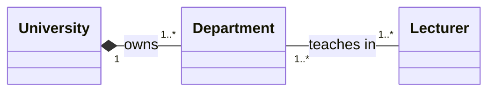

# Exercise 2: University Departments and Lecturers

- **University–Department:** composition. The filled diamond is at `University`; each department belongs to exactly one university, and a university contains one or more departments. Departments have no independent lifecycle apart from their university.
- **Department–Lecturer:** many-to-many association. Each department has one or more lecturers, and each lecturer teaches in one or more departments. This is a plain association because lecturers continue to exist and can be reassigned when a department is dissolved.
