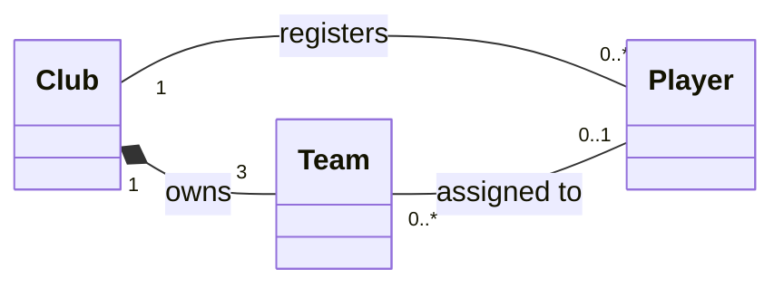

# Exercise 3: Football Club, Teams, and Players

- **Club–Team:** composition. The filled diamond at `Club` means the teams are owned by the club and cease to exist when it shuts down. Each club has three teams, and each team belongs to exactly one club.
- **Team–Player:** association. A team can have zero or more players, while a player can be unassigned or assigned to one team at a time. It is not composition: players survive a team disbandment and can be reassigned.
- **Club–Player:** registration association. Each player is registered with one club, which is independent of team assignment. A loan changes the assigned team without changing the registered club; a transfer changes the registered club.
