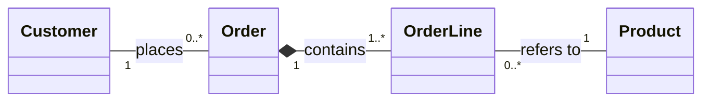

# Exercise 4: Customer Orders

- **Order–OrderLine:** composition. An order contains one or more order lines, and each line belongs to exactly one order. Deleting the order deletes its lines.
- **OrderLine–Product:** association. Each order line refers to exactly one product; a product can be referenced by zero or more order lines. The product exists independently of any order.
- **Customer–Order:** association. Each order belongs to one customer; a customer may have zero or more orders. Neither owns the lifecycle of the other.
