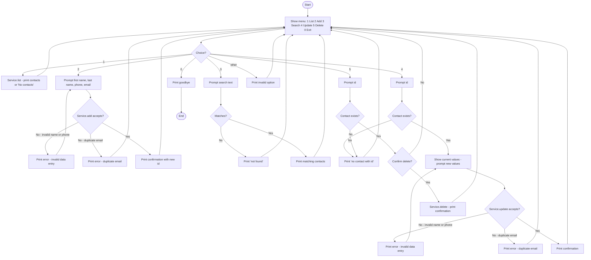
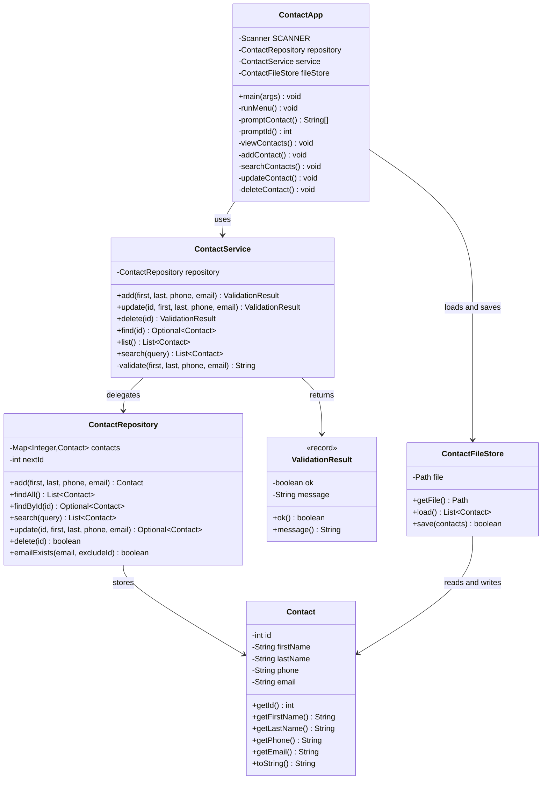

# Design – Contact Management App (ContactApp)

Console app for managing contacts: add, view, search, update and delete.

## Requirements analysis

**Functionality (basic scope)**

| # | Operation | User expectation |
|---|-----------|------------------|
| 1 | View all contacts | See everything currently stored |
| 2 | Add a contact | Enter name, phone, email and get confirmation or a clear error |
| 3 | Search | Find contacts by (part of) a name or phone number |
| 4 | Update | Change an existing contact, found by its id |
| 5 | Delete | Remove a contact by id, after confirmation |
| 0 | Exit | Close the app gracefully |

**Data** – a contact holds: `id` (int, generated), `firstName`, `lastName`, `phone`, `email` (Strings).

**Data structure** – `LinkedHashMap<Integer, Contact>`

- Keyed by id → O(1) `get`/`remove` for update and delete
- The map key itself guarantees unique ids (a state that must never be violated)
- Keeps insertion order → predictable listing (a `TreeMap` or sorting step would cover Challenge 1)
- Trade-off: search by name is O(n). Acceptable – a contact list is small and linear scans keep the code simple (KISS)

**Constraints – invalid states that must never be allowed**

1. Ids are auto-generated, never reused, never duplicated
2. Email must be unique – enforced by the repository (storage invariant)
3. Update/delete require an id that exists

**Input validation – data entry rules**

Enforced by `ContactService` before anything reaches the repository, so an invalid entry is never
stored. The service is the single gatekeeper – the UI does not validate on its own.

| # | Field | Rule | Error message |
|---|-------|------|---------------|
| V1 | first name | not blank after trim | `First name is required` |
| V2 | first name | must contain at least one letter – a name is text, not a number | `First name must be text, not numbers` |
| V3 | last name | not blank after trim | `Last name is required` |
| V4 | last name | must contain at least one letter | `Last name must be text, not numbers` |
| V5 | phone | not blank after trim | `Phone number is required` |
| V6 | phone | digits only (`0`–`9`) – no spaces, `+`, `-` or letters | `Phone number must contain digits only` |
| V7 | email | required after trim | `Email is required` |
| V8 | email | basic `local@domain.suffix` shape, no whitespace | `Email must have a valid address format` |
| V9 | names/email | no tabs or line breaks | `Contact fields must not contain tabs or line breaks` |

- Validation runs on the trimmed values, so `"  "` is blank and `" Alex "` is stored as `Alex`.
- The app re-prompts the form when the service rejects the input; the service never stores a rejected
  entry and the repository never sees it.
- Email is required and checked for a basic `local@domain.suffix` shape without whitespace.
  This is a basic input check, not full RFC 5322 validation or deliverability verification.
- Names and email must not contain tabs or line breaks so they can be persisted safely.
- Phone is kept as a `String` even though it only holds digits: a phone number is an identifier, not
  a quantity, so it must not lose leading zeros or be turned into an arithmetic value.

**Code organisation – separation of concerns**

| Class | Responsibility | Principle |
|-------|----------------|-----------|
| `Contact` | Data carrier only | SRP |
| `ContactRepository` | Storage, id generation, unique-email invariant | SRP, storage isolated |
| `ContactService` | Orchestration + business rules (validation, unique email, id exists) | Business rules isolated |
| `ContactFileStore` | Persistence of the app's own state to `contacts.txt` (load/save) | I/O isolated |
| `ContactApp` | Menu loop and `Scanner` I/O, nothing else | UI isolated |

The UI never touches the map directly and the repository never prints – each operation has one clear home.

## Flowchart



## Class diagram



## Test plan (Challenge 2)

`src/test/java/se/lexicon/` – JUnit 5, one positive and one negative case per data-access operation.

| Operation | Positive | Negative |
|-----------|----------|----------|
| `add` (repo) | stored with generated id, visible in `findAll` | duplicate email rejected |
| `search` (repo) | case-insensitive match on name/phone | no match → empty list |
| `update` (repo) | fields replaced, id kept | unknown id → empty |
| `delete` (repo) | removed, `findById` empty after | unknown id → `false`, list untouched |
| `add` (service) | valid input → ok | duplicate email → rejected |
| `update` (service) | valid → ok | unknown id, duplicate email |
| `delete` (service) | valid → ok | unknown id |
| validation (service) | valid names + digits-only phone accepted, surrounding whitespace trimmed | blank name, digits-only name, blank phone, phone with letters/spaces/symbols → rejected, nothing stored |

> Email tests cover null, blank, malformed and duplicate addresses on add and update.
> The rules live in `ContactService.validate` and are covered through the service – there is no separate validator class.

## Challenge 3 – File export/import: the I/O design

*Design first – the code comes after this section. Implemented in
`ContactExporter`, `ContactImporter`, `CsvContactExporter`,
`CsvContactImporter`, `ImportOutcome` and `ContactTransferService`.*

### Goal

Get the contacts in and out of the app through files:

- **Export** – write the current contacts to a file another program can read (Excel, LibreOffice, a mail merge)
- **Import** – read such a file back, keeping the contacts that are valid

### Two formats, two jobs

| File | Format | Written by | Read by | Purpose |
|------|--------|-----------|---------|---------|
| `contacts.txt` | tab-delimited, no header | `ContactFileStore` | `ContactFileStore` | the app's own state, rewritten on every exit |
| `contacts-export-*.csv` | CSV (RFC 4180) with a header row | `CsvContactExporter` | `CsvContactImporter` | portable hand-off to and from other programs |

One format, one writer, one parser. The app never reads its export file with the tab-delimited parser,
and never stores its own state as CSV.

### The CSV dialect

| Rule | Decision |
|------|----------|
| Delimiter | `,` |
| Header | `id,firstName,lastName,phone,email` – the columns are named, and the importer maps them by name so a reordered file still imports |
| Quoting | A field is wrapped in `"` when it contains `,`, `"`, CR or LF |
| Inner quotes | Doubled: `He said "hi"` → `"He said ""hi"""` |
| Line separator | CRLF (`\r\n`), as RFC 4180 asks – written by joining the lines, not by the platform default |
| Encoding | UTF-8, no BOM |
| Empty list | A file with only the header row |

```java
private static String escape(String field) {
    var needsQuotes = field.contains(",") || field.contains("\"")
            || field.contains("\n") || field.contains("\r");
    return needsQuotes ? "\"" + field.replace("\"", "\"\"") + "\"" : field;
}
```

### Import rules

The importer reuses the validation rules that already live in `ContactService` – a file must not be
able to insert a contact the console would reject.

1. The header row is read and mapped by column name; a missing column is an error (`Missing column: phone`), not a silent default
2. Every row is validated (name is text, phone is digits only, e-mail is not blank); a row that fails is **skipped with a warning** – `Row 4: phone must contain digits only` – and the rest of the file is still imported
3. Malformed quoting (a field that is never closed) → that row is skipped with a warning
4. A contact whose e-mail already exists in the app is skipped – the uniqueness invariant wins over the file
5. The id in the file is kept when it is a free number, otherwise a new id is generated; ids are never reused
6. All rows are parsed and validated **before** anything is stored → a broken file cannot leave the app half-imported

### I/O boundaries

The format classes never touch the disk, and the disk code never knows the CSV rules:

```java
public interface ContactExporter {
    String extension();                        // "csv"
    List<String> lines(List<Contact> contacts); // header + one escaped line per contact
}

public interface ContactImporter {
    ImportOutcome parse(List<String> lines);    // contacts + warnings for skipped rows
}

public record ImportOutcome(List<Contact> contacts, List<String> warnings) { }
```

| Class | Responsibility |
|-------|----------------|
| `CsvContactExporter` | The only class that knows the CSV dialect – escapes the fields, builds the header |
| `CsvContactImporter` | Splits a row into fields (a small state machine for the quoted fields), maps the columns, validates the values |
| `ContactTransferService` | Reads and writes the files (`Files.readAllLines` / `Files.write`, UTF-8), creates the parent folder, hands the lines to the format classes and reports the outcome |
| `ContactApp` | Menu entries `6. Export contacts` and `7. Import contacts`, prints the outcome |

The service takes the contacts as a parameter (`service.list()`) – it never reaches into the repository
itself, so an export is a read-only operation on the app's state.

### Menu and file names

```
6. Export contacts (CSV)
7. Import contacts (CSV)
```

- Export asks for a target path; the default is `contacts-export-YYYYMMDD-HHMMSS.csv` in the working directory, so an export never overwrites an earlier one
- A path without the `.csv` suffix gets the suffix added
- Import asks for the path of a `.csv` file and reports what was imported and what was skipped

### Failures

| Situation | Behaviour |
|-----------|-----------|
| Missing file, no permission, folder does not exist | A warning is printed, the app continues, the contacts in memory are unchanged |
| A row that fails validation | That row is skipped with a warning, the other rows are imported |
| An empty file | Nothing is imported, a warning says the file had no rows |
| Export of zero contacts | A file with only the header row is written |

### Test plan for the challenge

*Implemented in `CsvContactExporterTest`, `CsvContactImporterTest`,
`ContactTransferServiceTest` and the export/import cases in `ContactAppTest`.*

| Case | Expected |
|------|----------|
| Export two contacts | File with header + two rows |
| Name containing a comma | Field quoted: `"Smith, Jr"` |
| Name containing a quote | Inner quotes doubled |
| Empty contact list | File with only the header |
| Export to a missing folder | Folder created, or error message with no crash |
| Import a valid file | The contacts end up in the app with the same fields |
| Import a row with a bad phone | That row is skipped with a warning, the other rows are imported |
| Import a file with a missing column | Error message naming the column |
| Import a file with an e-mail that already exists | The row is skipped |
| Export → import | The same contacts come back (no duplicates – the e-mail check skips them) |
| Import a file that does not exist | Error message, the contacts in memory are unchanged |

Every validation rule V1–V9 is also asserted on the import path: a row that
fails any rule is skipped with `Row N: <reason>` and the rest of the file is
still imported. The rules are the same code – `CsvContactImporter` calls
`ContactService.validate` (package-private), so the console and the file
cannot drift apart.

### Known gaps

- `contacts.txt` is loaded without validation, so a file written before the validation rules existed (or hand-edited) can still hold an invalid contact. The import path is validated, the internal file is not – fixing that means validating on load.

### Explicitly out of scope for the challenge

- Excel `.xlsx` – needs a third-party library (Apache POI); a CSV that Excel opens is the cheaper 80 % solution
- A file-picker dialog – it is a console app, a typed path is enough
- Files that use `;` or a tab as the delimiter – only the RFC 4180 dialect is supported

## Out of scope (YAGNI – later challenges)

- Challenge 1: sorted output
- Full RFC email validation and deliverability verification
- GUI, database, networking
