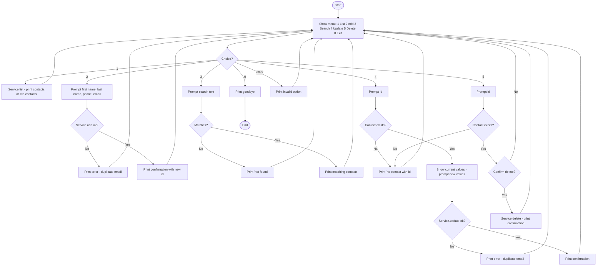
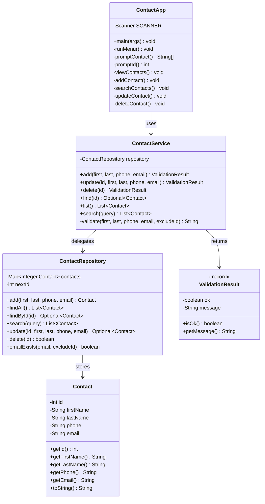

# Design – Contact Management App (ContactApp)

Console app for managing contacts: add, view, search, update and delete.

## Requirements analysis

**Functionality (basic scope)**

| # | Operation | User expectation |
|---|-----------|------------------|
| 1 | View all contacts | See everything currently stored |
| 2 | Add a contact | Enter name, phone, email and get confirmation or a clear error |
| 3 | Search | Find contacts by (part of) a name or phone number |
| 4 | Update | Change an existing contact, found by its id |
| 5 | Delete | Remove a contact by id, after confirmation |
| 0 | Exit | Close the app gracefully |

**Data** – a contact holds: `id` (int, generated), `firstName`, `lastName`, `phone`, `email` (Strings).

**Data structure** – `LinkedHashMap<Integer, Contact>`

- Keyed by id → O(1) `get`/`remove` for update and delete
- The map key itself guarantees unique ids (a state that must never be violated)
- Keeps insertion order → predictable listing (a `TreeMap` or sorting step would cover Challenge 1)
- Trade-off: search by name is O(n). Acceptable – a contact list is small and linear scans keep the code simple (KISS)

**Constraints – invalid states that must never be allowed**

1. Ids are auto-generated, never reused, never duplicated
2. Email must be unique – enforced by the repository (storage invariant)
3. Update/delete require an id that exists

> Input validation (non-blank names, email/phone format) is disabled for now and can be
> re-introduced as an extension. The service only guards the rules above.

**Code organisation – separation of concerns**

| Class | Responsibility | Principle |
|-------|----------------|-----------|
| `Contact` | Data carrier only | SRP |
| `ContactRepository` | Storage, id generation, unique-email invariant | SRP, storage isolated |
| `ContactService` | Orchestration + business rules (unique email, id exists) | Business rules isolated |
| `ContactApp` | Menu loop and `Scanner` I/O, nothing else | UI isolated |

The UI never touches the map directly and the repository never prints – each operation has one clear home.

## Flowchart

## Class diagram

## Test plan (Challenge 2)

`src/test/java/se/lexicon/` – JUnit 5, one positive and one negative case per data-access operation.

| Operation | Positive | Negative |
|-----------|----------|----------|
| `add` (repo) | stored with generated id, visible in `findAll` | duplicate email rejected |
| `search` (repo) | case-insensitive match on name/phone | no match → empty list |
| `update` (repo) | fields replaced, id kept | unknown id → empty |
| `delete` (repo) | removed, `findById` empty after | unknown id → `false`, list untouched |
| `add` (service) | valid input → ok | duplicate email → rejected |
| `update` (service) | valid → ok | unknown id, duplicate email |
| `delete` (service) | valid → ok | unknown id |

> Format validation (email/phone/blank) is out of scope for now, so no tests cover it.

## Out of scope (YAGNI – later challenges)

- Input validation (email/phone format, required fields) – deferred for now
- Challenge 1: sorted output
- Challenge 3: file export/import (plain text, CSV, Excel)
- GUI, database, networking
